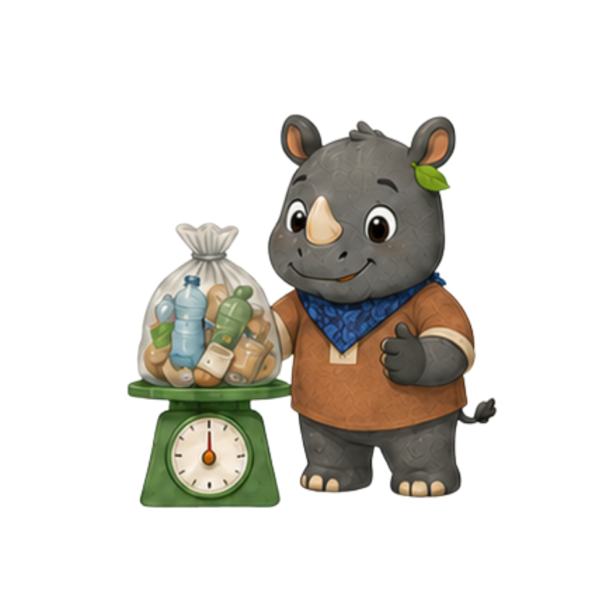
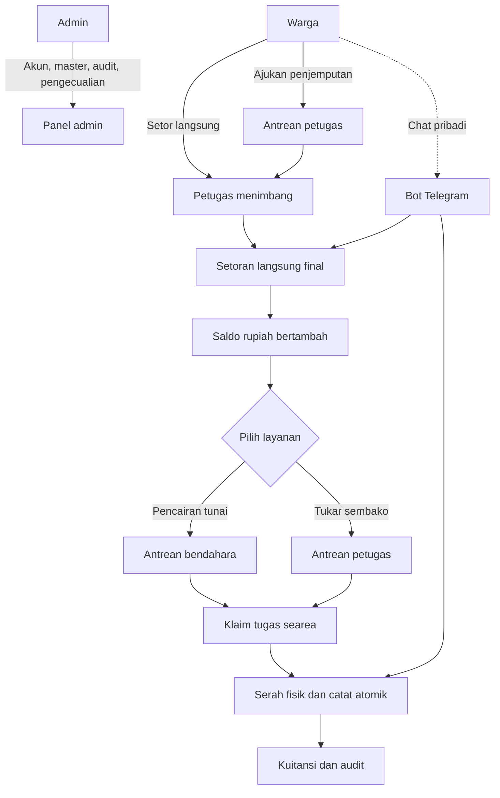
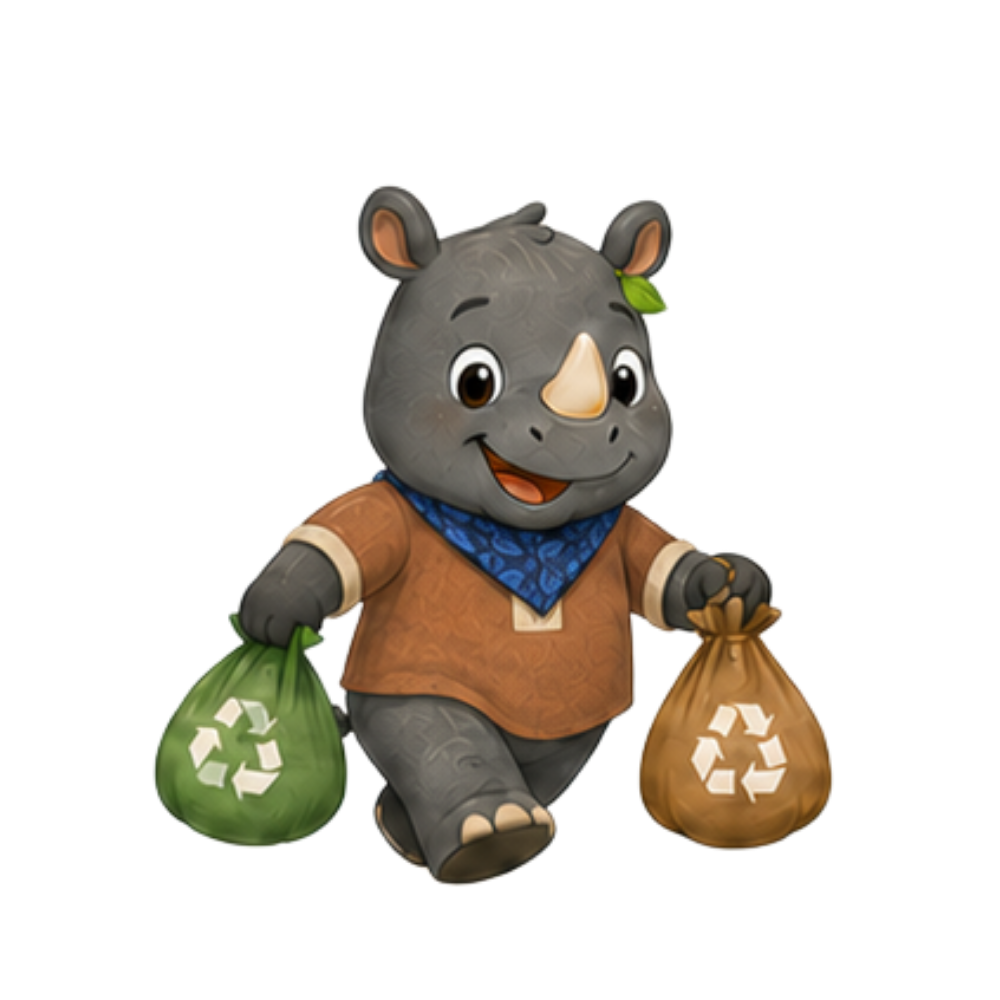

<p align="center">
  
  
  
  
</p>

<h1 align="center">Bank Sampah Digital Sindangheula</h1>

<p align="center">
  <strong>Dari sampah terpilah menjadi saldo yang tercatat.</strong><br>
  Sistem informasi bank sampah untuk warga <strong>Desa Sindangheula</strong>: setor sampah,
  pantau saldo rupiah, ajukan penjemputan, cairkan saldo, dan tukar sembako dalam satu alur.
</p>

<p align="center">
  
  
  
  
  
  
</p>

<p align="center">
  <a href="#alur-terbaru"><strong>Alur terbaru</strong></a> ·
  <a href="#maskot-sindangheula">Maskot</a> ·
  <a href="#jejak-prototipe">Jejak prototipe</a> ·
  <a href="#menjalankan-lokal">Menjalankan lokal</a> ·
  <a href="docs/README.md">Dokumentasi</a>
</p>

---

## Tentang Desa Sindangheula

**Bank Sampah Digital Sindangheula** adalah prototipe sistem informasi bank sampah untuk
**Desa Sindangheula**. Warga dapat menyetor sampah yang sudah dipilah, memantau saldo rupiah,
mengajukan penjemputan, mencairkan saldo tunai, dan menukar saldo dengan paket sembako.
Pengurus desa mengelola akun, wilayah, harga, laporan, dan audit melalui satu panel admin.

Aplikasi dirancang **mobile-first** agar nyaman dipakai lewat ponsel, baik oleh warga maupun
petugas di lapangan. Setiap transaksi yang sah menghasilkan mutasi saldo, kuitansi, dan jejak
audit yang dapat ditelusuri kembali.

> **Status:** prototipe penelitian. Bot Telegram **sudah aktif di production** dengan token dan
> webhook yang dikonfigurasi melalui environment server. Untuk instalasi baru, `.env.example`
> tetap memakai `TELEGRAM_ENABLED=false` sampai konfigurasi dan persetujuan privasi disiapkan.
> Tes otomatis bukan pengganti UAT peserta desa nyata.

## Alur terbaru

Alur saat ini sudah **tidak meminta persetujuan Admin rutin** untuk setiap transaksi.
Admin bekerja pada akun, data master, audit, koreksi resmi, dan pengecualian.



1. **Setoran langsung final.** Petugas memilih warga, mengisi jenis, kondisi, dan berat aktual,
   memeriksa total, lalu mencatat. Saldo bertambah dan kuitansi terbentuk dalam satu transaksi.
2. **Pickup memakai klaim pelaksana.** Warga mengajukan alamat, tanggal, dan jenis sampah.
   Petugas searea mengambil tugas sendiri, menjemput, lalu menyelesaikan penimbangan aktual.
3. **Pencairan tunai dan sembako memakai hold.** Pengajuan menahan saldo. Bendahara atau Petugas
   searea mengambil tugas hanya ketika uang atau paket benar-benar tersedia.
4. **Serah fisik dicatat satu kali.** Klaim mengikat pelaksana sebelum uang atau barang berpindah.
   Respons yang hilang tidak boleh memicu serah fisik kedua.
5. **Admin menangani pengecualian.** Jika serah fisik tidak dapat dipastikan, Admin memeriksa fakta,
   menulis alasan, dan melakukan autentikasi ulang. Ini bukan persetujuan rutin.
6. **Telegram adalah kanal yang sudah berjalan.** Di production, bot aktif dan memakai layanan
   domain serta pembukuan yang sama dengan web, bukan transaksi terpisah. Penautan awal dan
   pemutusan tetap melalui web.

**Yang tidak ada lagi:** persetujuan Admin berulang untuk setoran, pickup, pencairan, atau sembako;
transfer bank dan pembayaran sebagian; expiry otomatis pengajuan; serta kanal WhatsApp.

## Peran dan kewenangan

| Peran | Tugas utama | Batas |
| --- | --- | --- |
| **Warga** | Akun sendiri, saldo, riwayat, kartu QR, pengajuan pickup, pencairan, dan sembako. | Tidak dapat mencatat transaksi atau mengubah saldo. |
| **Petugas** | Identifikasi warga, setoran, pickup, layanan keliling, dan sembako pada area tugas aktif. | Tidak membayar tunai; hanya melihat riwayat pekerjaan sendiri. |
| **Bendahara** | Mengambil dan mencatat pembayaran tunai pada area tugas aktif. | Laporan hanya pembayaran sendiri; bukan approval Admin. |
| **Admin** | Akun, wilayah, harga, paket, laporan, audit, koreksi, exception, dan Health baca-saja. | Bukan pelaksana fisik rutin; Admin terakhir dilindungi. |

Satu akun memiliki **tepat satu peran**. Pengurus tidak merangkap tugas, dan tidak ada pengajuan
oleh pengurus atas nama Warga.

## Maskot Sindangheula

Maskot **badak** menjadi penanda visual sistem: ramah, teliti, dan dekat dengan kebiasaan
memilah sampah. Ia memakai bandana biru, rompi cokelat, dan daun kecil di telinga. Maskot yang
sama muncul di landing, dashboard, panel admin, halaman error, dan tutorial agar pengalaman
warga dan pengurus terasa satu kesatuan.

<table>
  <tr>
    <td align="center" width="25%">
      <br>
      <sub><strong>Sapa warga</strong><br>Menyambut di halaman masuk.</sub>
    </td>
    <td align="center" width="25%">
      <br>
      <sub><strong>Pilah sampah</strong><br>Memisahkan botol, kertas, dan logam.</sub>
    </td>
    <td align="center" width="25%">
      <br>
      <sub><strong>Layanan keliling</strong><br>Membawa sampah terpilah ke titik layanan.</sub>
    </td>
    <td align="center" width="25%">
      <br>
      <sub><strong>Konfirmasi</strong><br>Memberi tanda bahwa data sudah benar.</sub>
    </td>
  </tr>
  <tr>
    <td align="center" width="25%">
      <br>
      <sub><strong>Cari data</strong><br>Membantu admin menemukan akun dan warga.</sub>
    </td>
    <td align="center" width="25%">
      <br>
      <sub><strong>Timbang</strong><br>Memeriksa berat dan nilai setoran.</sub>
    </td>
    <td align="center" width="25%">
      <br>
      <sub><strong>Antrean tugas</strong><br>Menemani petugas memantau pekerjaan.</sub>
    </td>
    <td align="center" width="25%">
      <br>
      <sub><strong>Pilih langkah</strong><br>Menunjukkan alur layanan yang tepat.</sub>
    </td>
  </tr>
  <tr>
    <td align="center" width="25%">
      <br>
      <sub><strong>Pahami dulu</strong><br>Menemani warga membaca ketentuan dan harga.</sub>
    </td>
    <td align="center" width="25%">
      <br>
      <sub><strong>Daur ulang</strong><br>Mengingatkan bahwa sampah punya nilai.</sub>
    </td>
    <td align="center" width="25%">
      <br>
      <sub><strong>Tumbuh</strong><br>Merawat lingkungan dan saldo warga.</sub>
    </td>
    <td align="center" width="25%">
      <br>
      <sub><strong>Verifikasi</strong><br>Menyambut pemeriksaan bukti setoran.</sub>
    </td>
  </tr>
</table>

## Jejak prototipe

Repo ini menyimpan perjalanan prototipe, dari alur yang masih meminta persetujuan Admin
berulang hingga alur klaim saat ini dan kanal Telegram. Rincian tahapan ada di
[linimasa prototipe](docs/RESEARCH_TIMELINE.md).

| Tanggal | Tahap | Perubahan utama |
| --- | --- | --- |
| 4–5 Okt 2026 | Prototipe awal | Setoran, pickup, pencairan, dan sembako masih melalui review atau keputusan Admin. |
| 5 Okt 2026 | Cutover empat peran | Persetujuan rutin dihapus; setoran langsung final; layanan memakai klaim pelaksana searea. |
| 8–9 Okt 2026 | UI dan data | Statistik landing, foto katalog, data master privat, dan copy publik dirapikan. |
| 17–24 Okt 2026 | Penyempurnaan | Hero maskot, riwayat petugas, akun Green Ledger, dan tutorial video. |
| 25–28 Okt 2026 | Bot Telegram | Penautan 1:1, consent opt-in, webhook, akses persisten, privasi v2.1, dan persiapan production. |
| 29 Okt–4 Nov 2026 | Penutupan prototipe | README, linimasa penelitian, changelog rilis, dan dokumentasi akhir. |

## Fitur utama

- **Publik:** landing desa, ringkasan statistik, katalog sampah, harga aktif, pengumuman,
  program, jadwal layanan keliling, tutorial video, dan verifikasi bukti setoran.
- **Warga:** dashboard saldo, setoran, pengajuan pickup, pencairan tunai, penukaran sembako,
  kartu nasabah ber-QR, riwayat, dan kuitansi.
- **Petugas:** identifikasi warga, setoran langsung, tugas pickup, layanan keliling, sembako,
  dan riwayat pekerjaan sendiri.
- **Bendahara:** antrean pembayaran tunai, pencatatan serah fisik, kuitansi, dan laporan pribadi.
- **Admin:** akun dan area tugas, verifikasi warga, wilayah, jenis sampah dan harga, paket sembako,
  laporan, audit, rekonsiliasi, koreksi resmi, exception, dan Health baca-saja.
- **Telegram:** menu Warga, Petugas, dan Bendahara; penimbangan/finalisasi, pickup, sembako,
  layanan keliling, notifikasi opt-in, pengingat, dan ekspor laporan pribadi.

### Kanal Telegram di production

Bot Telegram aktif di production dan membaca konfigurasi dari environment server:

| Variabel | Fungsi |
| --- | --- |
| `TELEGRAM_ENABLED` | `true` di production; `false` adalah bawaan `.env.example` untuk instalasi baru. |
| `TELEGRAM_BOT_TOKEN` | Token BotFather, hanya disimpan di environment server. |
| `TELEGRAM_BOT_USERNAME` | Username bot tanpa `@`. |
| `TELEGRAM_WEBHOOK_SECRET` | Secret header untuk memverifikasi webhook. |

Token, secret, dan isi `.env` tidak pernah masuk repo. Prosedur penautan, pendaftaran webhook,
scheduler, dan penghentian kanal ada di [panduan kanal Telegram](docs/TELEGRAM_CHANNEL.md).

## Teknologi

| Lapisan | Teknologi |
| --- | --- |
| Backend | Laravel 13, PHP 8.3+, MySQL 8.0.30/InnoDB |
| Antarmuka | Livewire 4, Filament 5, Blade, Tailwind CSS 4, Lucide |
| Build | Vite 8, Node.js 22 |
| Integrasi | Telegram Bot API (webhook, outbox idempoten, consent) |
| Pengujian | Pest, PHPStan/Larastan, Pint, Playwright, uji MySQL disposable |

## Menjalankan lokal

1. Siapkan PHP 8.3+, Composer, Node.js 22/npm, dan MySQL lokal (misalnya Laragon).
2. Jalankan `composer install` dan `npm ci --ignore-scripts`.
3. Salin `.env.example` ke `.env`, isi koneksi database dan URL, lalu jalankan
   `php artisan key:generate`.
4. Siapkan data utama privat mengikuti [panduan seeder](docs/SEEDING.md). Tanpa sumber ini,
   seeder lokal berhenti dan tidak diganti dengan akun buatan.
5. Pada database lokal kosong, jalankan `php artisan migrate --seed`, lalu `npm run build`.
6. Arahkan document root ke `public/`, atau jalankan `php artisan serve`.

```bash
composer install
npm ci --ignore-scripts
cp .env.example .env
php artisan key:generate
php artisan migrate --seed
npm run build
php artisan serve
```

Data akun, alamat, dan hash kata sandi disimpan privat di `database/data/master-data.json`
dan diabaikan Git. Di production, seeder biasa hanya membuat Admin awal sesuai konfigurasi;
akun yang sudah ada tidak ditimpa.

## Pengujian

```bash
composer check          # Pint, PHPStan, dan Pest
composer test           # Pest saja
npm run build
npm run test:browser-guard
npm run test:browser    # butuh database uji dan server lokal
```

Unit/feature memakai SQLite memori dan storage/cache/sesi terpisah. Pengujian MySQL/browser
hanya memakai database disposable `bank_sampah_test` atau suffix-nya, URL loopback, dan token
preflight yang sesuai. Lihat [rencana tes](docs/TEST_PLAN.md) untuk batas bukti.

## Struktur repo

```text
app/
  Domain/                  aturan bisnis, layanan, model, dan enum
  Livewire/                antarmuka Warga, Petugas, Bendahara, dan publik
  Filament/                panel Admin
  Http/Controllers/        webhook Telegram dan controller web
  Authorization/           peran, izin, dan batas area
docs/                      kontrak, panduan, validasi, dan linimasa
documents/                 proposal dan flowchart penelitian
public/images/landing/     maskot dan foto landing
resources/views/           Blade, komponen UI, dan layout
tests/                     Pest, browser, dan uji MySQL
```

## Dokumentasi

- [Workflow web dan Telegram](docs/WEB_WORKFLOW.md)
- [Panduan tiap pengguna](docs/USER_FLOWS.md)
- [Aturan bisnis](docs/BUSINESS_RULES.md)
- [Peran dan izin](docs/PERMISSIONS.md)
- [Arsitektur](docs/ARCHITECTURE.md) dan [model data](docs/DATA_MODEL.md)
- [Kanal Telegram](docs/TELEGRAM_CHANNEL.md)
- [Keamanan](docs/SECURITY.md), [operasional](docs/OPERATIONS.md), dan [deployment](docs/DEPLOYMENT.md)
- [Rencana tes](docs/TEST_PLAN.md) dan [bukti UAT](docs/UAT_EVIDENCE.md)
- [Linimasa prototipe](docs/RESEARCH_TIMELINE.md)
- [Catatan perubahan](docs/CHANGELOG.md), [roadmap](docs/ROADMAP.md), dan [kaitan skripsi](docs/SKRIPSI.md)
- [Kontrak desain](DESIGN.md) dan [indeks dokumentasi](docs/README.md)

Proposal dan sembilan flowchart ada di [`documents/`](documents/).

## Keamanan dan privasi

- `.env`, token, backup, database, log, dan kredensial nyata tidak boleh diunggah ke GitHub.
- Lampiran rutin bersifat privat dan tervalidasi; foto katalog publik dinormalisasi tanpa EXIF/GPS.
- Telegram memakai penautan 1:1 dan consent terpisah yang opt-in; production sudah aktif,
  sedangkan `.env.example` tetap default nonaktif untuk instalasi baru.
- Statistik publik melindungi kelompok kecil dan tidak memuat data pribadi.
- Kuitansi/audit adalah jejak sistem, bukan bukti independen serah fisik.
- UAT dan SUS tidak diklaim selesai sebelum ada peserta; kanal Telegram production sudah
  berjalan, tetapi itu bukan pengganti bukti UAT.

## Penelitian

**Judul:** Pengembangan Sistem Informasi Bank Sampah dengan Integrasi Bot Telegram:
Studi Kasus Desa Sindangheula

**Penulis:** Muhammad Faiz Bintang Pratama — Informatika, Fakultas Teknik,
Universitas Sultan Ageng Tirtayasa, 2026

Repo ini adalah objek penelitian dan prototipe teknis. Data warga, dokumen skripsi, dan
instrumen penelitian tetap berada di luar repositori publik.

## Lisensi

Metadata package memakai lisensi MIT. Distribusi kode, data, dan aset mengikuti kebijakan
proyek serta persetujuan pemilik data Desa Sindangheula.
